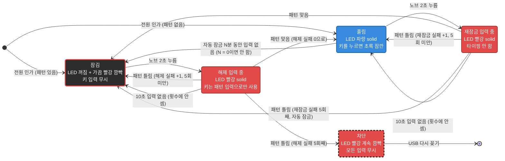

# USB-mini-keyboard-6k1n

상용 CH552G 미니 매크로 키보드에 커스텀 펌웨어를 올려 키마다 **긴 문자열**을 HID 키보드로 출력하는 프로젝트.

- 대상: 키 6개 + 노브 1개 ([핀 배치](docs/PINMAP.md))
  - **MK6K1N**: LED 1개
  - **MK6K1NL**: 키마다 LED
- PC GUI에서 문자열 확인·수정
- 펌웨어 업로드, 설정, 문자열 출력을 모두 USB 포트 하나로 처리

## 핵심 요구사항

| # | 요구사항 | 현재 상태 |
|---|---|---|
| 1 | 시중 매크로 키보드의 **핀맵을 식별해서 펌웨어를 개조** | ✅ 핀맵 식별 완료(`firmware/test_pinmap`), 본 펌웨어 v1.0 작성, 실제 장치에서 동작 확인 (2026-10-26) |
| 2 | **키마다 길게(약 20자 이상)** 입력 (원래 제품은 약 8자) | ✅ 9개 슬롯이 **합계 102자**(DataFlash 128바이트)를 나눠 씀. 노브에 키 하나씩 넣으면 키 6개 합계 85자(평균 약 14자), 키마다 길이는 자유 배분. **GUI가 전체·남은 글자 수를 계산해 저장 가능 여부 표시** |
| 3 | 노브는 **단순 기능**(방향키, Enter 등 키 하나)으로 충분 | ✅ 노브 시계 방향/반시계 방향/누르기에 키 하나 또는 짧은 매크로 할당 |
| 4 | **연결할 때마다 패턴 암호를 입력해야 출력**(아무나 못 쓰게). 패턴은 GUI에서 설정. 입력 전 빨간 LED, 통과 후 파란 LED | ✅ 펌웨어 v1.1 / GUI 1.1, 실제 장치에서 동작 확인 (2026-10-26) |

> **결정 (2026-10-26)**: 코드 Flash는 쓰지 않고 DataFlash만 사용함.
> - 6개 키 모두 20자를 동시에 넣을 수는 없음
> - 길이 배분은 GUI의 용량 표시로 관리

## 현재 상태

| 항목 | 상태 |
|---|---|
| 하드웨어 조사 (핀 매핑, LED, 부트로더) | ✅ 완료 (`firmware/test_pinmap`으로 확인) |
| 설정 통신 규격 | ✅ [docs/PROTOCOL.md](docs/PROTOCOL.md) |
| 설정 GUI | ✅ 실제 장치와 동작 확인 (2026-10-26). 키보드 없이 `--mock`으로도 실행 가능 |
| 본 펌웨어 v1.0 ([firmware/macro_keyboard](firmware/macro_keyboard/)) | ✅ 실제 장치에서 동작 확인 (2026-10-26). 빌드와 PC 검사(host_test) 통과 |
| 패턴 암호 (펌웨어 v1.1, 프로토콜 v2) | ✅ 실제 장치에서 동작 확인 (2026-10-26). 빌드, host_test, GUI 테스트 통과. 확인 절차: [firmware/macro_keyboard/README.md](firmware/macro_keyboard/README.md#4-잠금-확인) |
| 잠금 개선 (펌웨어 v1.2) | ✅ 잠긴 동안 키 무시, 노브 길게 누르기로 패턴 입력 시작, 다시 잠그기 ([잠금 상태도](#잠금-상태도)) |
| 펌웨어 크기 줄이기 (v1.2.1) | ✅ 기능은 그대로 11,587 → 8,151바이트 ([docs/FIRMWARE_SIZE.md](docs/FIRMWARE_SIZE.md)) |
| 보드 정보 (펌웨어 v1.3, GUI 1.3) | ✅ HELLO로 칩·키/노브 수·보드 이름을 알리고 GUI가 그 배치로 화면 구성. 펌웨어 업데이트 창은 보드 목록·칩 표로 업로더 옵션 선택, hex의 식별 문자열 확인 ([docs/BOARD_INFO.md](docs/BOARD_INFO.md)) |
| 노브 2초, 자동 잠금 (펌웨어 v1.4, GUI 1.4) | ✅ 패턴 입력 시작이 노브 2초. 풀린 뒤 N분(GUI에서 설정, 0 = 안 함) 입력 없으면 자동 잠김. 실제 장치에서 확인 (2026-10-27) |
| MK6K1NL: 키마다 LED가 있는 6키 보드 (펌웨어 v1.5, GUI 1.5) | 핀은 MK6K1N과 같고 LED가 키마다 하나(`firmware/test_mk6k1nl`로 확인, 2026-10-31). 누른 키의 LED만 초록, 나머지는 파랑. 보드 파일 `mk6k1nl.h`, 펌웨어 `macro_keyboard-MK6K1NL.hex` |
| 패턴 2~8단계, 입력 표시, 장입할 보드 고르기 (펌웨어 v1.6, GUI 1.6) | 패턴 암호 2단계부터 가능(전에는 4단계). MK6K1NL은 패턴 입력 중 누른 키의 LED가 잠깐 꺼짐. 펌웨어 업데이트 창에서 장입할 보드 선택, 식별 못 한 키보드(공장 펌웨어 등)도 확인 후 장입 |
| 다른 키보드 (8키, 9키 CH57x) | 계획 중 ([docs/BOARD_INFO.md](docs/BOARD_INFO.md) 7~8절) |

## 잠금 상태도

- 펌웨어 v1.2 이후의 잠금 동작
  - v1.3.1: 노브 3초 → 2초
  - v1.4: 자동 잠금 추가
  - v1.6: 패턴 2~8단계
- 사용 방법·확인 절차: [firmware/macro_keyboard/README.md](firmware/macro_keyboard/README.md#잠금)
- v1.1은 잠긴 동안 키 입력을 바로 패턴으로 받았고, 다시 잠그기가 없었음



### 그림 읽는 법

- 박스 색 = 그 상태의 LED 색
- 검정 바탕 + 빨간 테두리 = 꺼져 있고 가끔 빨강 깜빡
- 점선 테두리 = 계속 깜빡임
- 풀림에서 키를 누를 때의 초록은 잠깐 켜졌다 돌아오므로 별도 박스 없음

### 상태별 LED

| 상태 | LED |
|---|---|
| 잠김 (전원 인가 직후 포함) | 꺼짐, 약 3초마다 빨강 짧게(0.1초) 깜빡임 |
| 해제 입력 중 / 재잠금 입력 중 | 빨강 solid |
| 차단 (해제 실패 5회) | 빨강 계속 깜빡임 (약 0.5초 간격) |
| 풀림 | 파랑 solid |
| 풀림에서 키를 누름 | 초록 잠깐 켜짐 (문자열 출력 동안, 최소 0.2초) |
| 설정 저장 완료 | 흰색 0.3초 (변경 없음) |
| 부트로더 진입 | 보라 (변경 없음) |

### 동작 규칙

- 패턴이 틀리면 그 자리에서 다시 받지 않고 이전 상태(잠김 또는 풀림)로 돌아감. 다시 하려면 노브 2초부터
- 재잠금 실패 5회로 자동 잠금되면 '차단'이 아니라 '잠김'이 됨
  - 노브 2초 + 맞는 패턴으로 바로 풀 수 있음
  - 해제 실패 횟수는 새로 5번
- 재잠금 실패 횟수는 재잠금 성공 또는 잠김에서 다시 풀리면 0이 됨
- **자동 잠금** (v1.4): GUI에서 정한 N분(0~255) 동안 입력이 없으면 풀림 → 잠김
  - 입력 = 키/노브 입력, GUI 작업(읽기·저장·테스트 입력)
  - 0분이면 자동 잠금 안 함
  - 해제 실패 횟수는 새로 5번
- 패턴 암호가 저장되어 있으면 노브 누르기 문자열은 뗄 때(2초 미만) 입력됨
- 꽂는 순간 노브를 누르고 있으면 부트로더로 들어가므로, 노브 2초 누르기는 꽂은 뒤에 함

## 하드웨어 요약

| 입력 | GPIO |
|---|---|
| 키 A / B / C (윗줄) | P1.1 / P1.7 / P1.6 |
| 키 D / E / F (아랫줄) | P1.5 / P1.4 / P3.2 |
| 노브 회전 | P3.0 / P3.1 |
| 노브 누르기 | P3.3 |
| LED | P3.4, WS2812 (GRB) |

- MCU: CH552G (Flash 16KB, RAM 1KB + 256B, DataFlash 128B), ROM 부트로더 2.5.0
- 부트로더 진입: **키 D를 누른 채 USB 연결** (제조사 펌웨어가 있을 때는 키 E)

## 폴더 구조

| 경로 | 내용 |
|---|---|
| [docs/MANUAL.md](docs/MANUAL.md) | **사용 설명서**: 키보드 사용 방법(LED, 패턴 암호), 설정 프로그램(GUI) 사용 방법 |
| [PLAN.md](PLAN.md) | 전체 계획, 하드웨어 조사 기록, 단계별 진행 |
| [docs/PROTOCOL.md](docs/PROTOCOL.md) | 펌웨어와 GUI가 공유하는 Vendor HID 설정 통신 규격 |
| [docs/TROUBLESHOOTING.md](docs/TROUBLESHOOTING.md) | 실제로 겪은 문제와 해결 방법(빌드 오류, 업로드 실패와 복구 등) |
| [docs/PINMAP.md](docs/PINMAP.md) | **키보드별 핀 배치**: CH552G 핀, MK6K1N·MK6K1NL 배치와 LED 체인 다이어그램, 노브 신호 |
| [docs/BOARD_INFO.md](docs/BOARD_INFO.md) | 보드 정보 설계: 여러 키보드(보드) 지원, 보드 목록, 칩 표, CH57x 이식 방침 |
| [docs/FIRMWARE_SIZE.md](docs/FIRMWARE_SIZE.md) | 펌웨어 크기 줄이기 제안과 단계별 결과 |
| [firmware/macro_keyboard/](firmware/macro_keyboard/) | 본 펌웨어 (빌드, 업로드, 동작 테스트 방법 포함) |
| [firmware/test_pinmap/](firmware/test_pinmap/) | MK6K1N 하드웨어 확인용 테스트 펌웨어. **새 장치를 구하면 먼저 이걸로 점검** |
| [firmware/test_mk6k1nl/](firmware/test_mk6k1nl/) | MK6K1NL(키마다 LED) 하드웨어 확인용 테스트 펌웨어: LED 체인 순서와 키 핀 |
| [firmware/host_test/](firmware/host_test/) | 본 펌웨어의 저장/매크로 코드를 PC(gcc)에서 검사 |
| [gui/](gui/) | PySide6 설정 프로그램 |
| [tools/](tools/) | 개발용 스크립트 (아래 표) |

| tools/ 파일 | 용도 |
|---|---|
| `flash.ps1` | 부트로더 대기 후 자동 업로드 |
| `usb_monitor.ps1` | USB 장치 감지 기록 |
| `build_fw.ps1` | 펌웨어 빌드, `-Board`로 보드 선택, 빌드 일자 기록 |
| `build_gui.ps1` | GUI exe 빌드, 빌드 일자 기록 |
| `capture_screens.py` | 문서용 GUI 화면 캡처 |
| `draw_pinmap.py` | 문서용 보드별 핀 그림 |

## 빠른 시작

- 사용 방법: [사용 설명서(docs/MANUAL.md)](docs/MANUAL.md)
- 아래는 개발용 빌드·실행 방법

### 펌웨어 빌드

- 환경: Arduino IDE + CH55xDuino 0.0.26
- 보드 설정, Windows 빌드 오류 패치: [firmware/test_pinmap/README.md](firmware/test_pinmap/README.md)
- 빌드 일자를 넣으려면 스크립트로 빌드 (버전은 `firmware/macro_keyboard/src/config.h`)

```powershell
powershell -ExecutionPolicy Bypass -File tools\build_fw.ps1
```

- 결과 (`firmware\macro_keyboard\build\`)
  - `macro_keyboard-MK6K1N.hex`: 보드 이름이 붙은 파일, GUI가 먼저 고름
  - `macro_keyboard.ino.hex`
- 키마다 LED가 있는 보드: `-Board mk6k1nl`로 빌드 → `macro_keyboard-MK6K1NL.hex`

### 펌웨어 업로드

1. 스크립트 실행

   ```powershell
   powershell -ExecutionPolicy Bypass -File tools\flash.ps1 -Hex <빌드한 .hex 파일>
   ```

2. 키 D를 누른 채 키보드 연결

### GUI 실행

- 설치 방법: [gui/README.md](gui/README.md)

```powershell
gui\.venv\Scripts\python -m gui --mock
```

### GUI exe 빌드

- 빌드 일자가 exe에 기록됨, 버전은 `gui/version.py`

```powershell
powershell -ExecutionPolicy Bypass -File tools\build_gui.ps1
```

## 라이선스 참고

- `firmware/test_pinmap/src/userUsbHidKeyboard/`의 USB 코드: [CH55xDuino](https://github.com/DeqingSun/ch55xduino) HidKeyboard 예제에서 가져옴 (LGPL-2.1)
