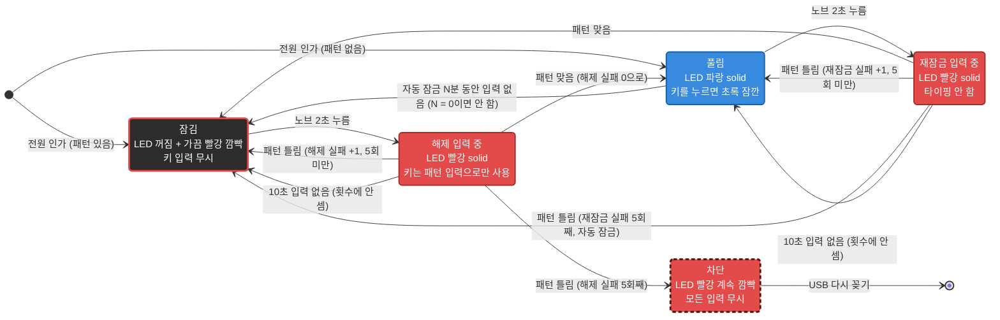

# USB-mini-keyboard-6k1n

상용 CH552G 미니 매크로 키보드(키 6개 + 노브 1개)에 커스텀 펌웨어를 올려서, 키마다 **긴 문자열**을 HID 키보드 입력으로 출력하고 PC의 GUI 프로그램에서 문자열을 확인하고 수정하는 프로젝트입니다. 펌웨어 업로드, 설정, 문자열 출력을 모두 USB 포트 하나로 처리합니다.

## 핵심 요구사항

| # | 요구사항 | 현재 상태 |
|---|---|---|
| 1 | 시중 매크로 키보드의 **핀맵을 식별해서 펌웨어를 개조**할 것 | ✅ 핀맵 식별 완료(`firmware/test_pinmap`), 본 펌웨어 v1.0 작성, 실제 장치에서 동작 확인 (2026-10-26) |
| 2 | **키마다 길게(약 20자 이상)까지** 입력할 수 있을 것 (원래 제품은 약 8자) | ✅ 9개 슬롯이 **합계 102자**(DataFlash 128바이트)를 나눠 씀. 노브에 키 하나씩 넣으면 키 6개 합계 85자(평균 약 14자)이고, 키마다 길이는 자유롭게 배분. **GUI가 전체 글자 수와 남은 글자 수를 계산해서 저장 가능 여부를 알려줌** |
| 3 | 노브는 **단순 기능**(방향키, Enter 등 키 하나)으로도 충분함 | ✅ 노브 시계 방향/반시계 방향/누르기에 키 하나 또는 짧은 매크로 할당 |
| 4 | 아무나 눌러 쓰지 못하도록 **연결할 때마다 패턴 암호를 입력해야 출력**될 것. 패턴 암호는 GUI에서 설정. 입력 전 빨간 LED, 통과 후 파란 LED | ✅ 펌웨어 v1.1 / GUI 1.1, 실제 장치에서 동작 확인 (2026-10-26) |

> **결정 (2026-10-26)**: 코드 Flash에는 쓰지 않고 DataFlash만 사용합니다. 6개 키 모두 20자를 동시에 넣을 수는 없지만, 길이 배분은 GUI의 용량 표시로 관리합니다.

## 현재 상태

| 항목 | 상태 |
|---|---|
| 하드웨어 조사 (핀 매핑, LED, 부트로더) | ✅ 완료 (`firmware/test_pinmap`으로 확인) |
| 설정 통신 규격 | ✅ [docs/PROTOCOL.md](docs/PROTOCOL.md) |
| 설정 GUI | ✅ 실제 장치와 동작 확인 (2026-10-26). 키보드 없이 `--mock`으로도 실행 가능 |
| 본 펌웨어 v1.0 ([firmware/macro_keyboard](firmware/macro_keyboard/)) | ✅ 실제 장치에서 동작 확인 (2026-10-26). 빌드와 PC 검사(host_test) 통과 |
| 패턴 암호 (펌웨어 v1.1, 프로토콜 v2) | ✅ 실제 장치에서 동작 확인 (2026-10-26). 빌드, host_test, GUI 테스트 통과. 확인 절차는 [firmware/macro_keyboard/README.md](firmware/macro_keyboard/README.md#4-잠금-확인) |
| 잠금 개선 (펌웨어 v1.2) | ✅ 잠긴 동안 키 무시, 노브 길게 누르기로 패턴 입력 시작, 다시 잠그기 ([잠금 상태도](#잠금-상태도)) |
| 펌웨어 크기 줄이기 (v1.2.1) | ✅ 기능은 그대로 11,587 → 8,151바이트 ([docs/FIRMWARE_SIZE.md](docs/FIRMWARE_SIZE.md)) |
| 보드 정보 (펌웨어 v1.3, GUI 1.3) | ✅ HELLO로 칩·키/노브 수·보드 이름을 알리고 GUI가 그 배치로 화면을 만듦. 펌웨어 업데이트 창은 보드 목록과 칩 표로 업로더 옵션을 고르고 hex의 식별 문자열을 확인 ([docs/BOARD_INFO.md](docs/BOARD_INFO.md)) |
| 노브 2초, 자동 잠금 (펌웨어 v1.4, GUI 1.4) | ✅ 패턴 입력 시작이 노브 2초. 풀린 뒤 N분(GUI에서 설정, 0 = 안 함) 동안 입력이 없으면 자동으로 잠김. 실제 장치에서 확인 (2026-10-27) |
| 다른 키보드 (8키, 9키 CH57x) | 계획 중 ([docs/BOARD_INFO.md](docs/BOARD_INFO.md) 7~8절) |

## 잠금 상태도

> 펌웨어 v1.2 이후의 잠금 동작입니다(v1.3.1에서 노브 3초 → 2초, v1.4에서 자동 잠금 추가). 사용 방법과 확인 절차는 [firmware/macro_keyboard/README.md](firmware/macro_keyboard/README.md#잠금)를 보세요. (v1.1은 잠긴 동안 키 입력을 바로 패턴으로 받았고, 다시 잠그기가 없었습니다.)



박스 색은 그 상태의 LED 색입니다. 검정 바탕에 빨간 테두리는 "꺼져 있고 가끔 빨강 깜빡", 점선 테두리는 "계속 깜빡임"을 뜻합니다. 풀림 상태에서 키를 누를 때의 초록은 잠깐 켜졌다 돌아오는 것이라 박스로 나누지 않았습니다.

| 상태 | LED |
|---|---|
| 잠김 (전원 인가 직후 포함) | 꺼져 있고, 약 3초마다 빨강이 짧게(0.1초) 깜빡임 |
| 해제 입력 중 / 재잠금 입력 중 | 빨강 solid |
| 차단 (해제 실패 5회) | 빨강이 계속 깜빡임 (약 0.5초 간격) |
| 풀림 | 파랑 solid |
| 풀림에서 키를 누름 | 초록이 잠깐 켜짐 (문자열을 출력하는 동안, 최소 0.2초) |

설정 저장 완료(흰색 0.3초)와 부트로더 진입(보라)은 그대로입니다.

- 패턴이 틀리면 그 자리에서 다시 받지 않고 이전 상태(잠김 또는 풀림)로 돌아갑니다. 다시 하려면 노브 2초부터 시작합니다.
- 재잠금 실패 5회로 자동 잠금되면 '차단'이 아니라 '잠김'이 됩니다. 노브 2초 + 맞는 패턴으로 바로 풀 수 있고, 해제 실패 횟수는 새로 5번입니다.
- 재잠금 실패 횟수는 재잠금에 성공하거나 잠김에서 다시 풀리면 0이 됩니다.
- **자동 잠금** (v1.4): GUI에서 정한 시간(N분, 0~255) 동안 키/노브 입력과 GUI 작업(읽기·저장·테스트 입력)이 없으면 풀림에서 잠김으로 갑니다. 0분이면 자동 잠금을 하지 않습니다. 해제 실패 횟수는 새로 5번입니다.
- 패턴 암호가 저장되어 있으면 노브 누르기 문자열은 뗄 때(2초 미만) 입력됩니다.
- 꽂는 순간 노브를 누르고 있으면 부트로더로 들어가므로, 노브 2초 누르기는 꽂은 뒤에 합니다.

## 하드웨어 요약

| 입력 | GPIO |
|---|---|
| 키 A / B / C (윗줄) | P1.1 / P1.7 / P1.6 |
| 키 D / E / F (아랫줄) | P1.5 / P1.4 / P3.2 |
| 노브 회전 | P3.0 / P3.1 |
| 노브 누르기 | P3.3 |
| LED | P3.4, WS2812 (GRB) |

- MCU: CH552G (Flash 16KB, RAM 1KB + 256B, DataFlash 128B), ROM 부트로더 2.5.0
- 부트로더 진입: **키 D를 누른 채 USB 연결** (제조사 펌웨어가 있을 때는 키 E)

## 폴더 구조

| 경로 | 내용 |
|---|---|
| [docs/MANUAL.md](docs/MANUAL.md) | **사용 설명서**: 키보드 사용 방법(LED, 패턴 암호)과 설정 프로그램(GUI) 사용 방법 |
| [PLAN.md](PLAN.md) | 전체 계획, 하드웨어 조사 기록, 단계별 진행 |
| [docs/PROTOCOL.md](docs/PROTOCOL.md) | 펌웨어와 GUI가 공유하는 Vendor HID 설정 통신 규격 |
| [docs/TROUBLESHOOTING.md](docs/TROUBLESHOOTING.md) | 빌드 오류, 업로드 실패와 복구 등 실제로 겪은 문제와 해결 방법 |
| [docs/BOARD_INFO.md](docs/BOARD_INFO.md) | 보드 정보 설계: 여러 키보드(보드) 지원, 보드 목록, 칩 표, CH57x 이식 방침 |
| [docs/FIRMWARE_SIZE.md](docs/FIRMWARE_SIZE.md) | 펌웨어 크기 줄이기 제안과 단계별 결과 |
| [firmware/macro_keyboard/](firmware/macro_keyboard/) | 본 펌웨어 (빌드, 업로드, 동작 테스트 방법 포함) |
| [firmware/test_pinmap/](firmware/test_pinmap/) | 하드웨어 확인용 테스트 펌웨어. **새 장치를 구하면 먼저 이걸로 점검** |
| [firmware/host_test/](firmware/host_test/) | 본 펌웨어의 저장/매크로 코드를 PC(gcc)에서 검사 |
| [gui/](gui/) | PySide6 설정 프로그램 |
| [tools/](tools/) | `flash.ps1`(부트로더 대기 후 자동 업로드), `usb_monitor.ps1`(USB 장치 감지 기록), `build_fw.ps1`(펌웨어 빌드, `-Board`로 보드 선택, 빌드 일자 기록), `build_gui.ps1`(GUI exe 빌드, 빌드 일자 기록), `capture_screens.py`(문서용 GUI 화면 캡처) |

## 빠른 시작

사용 방법은 [사용 설명서(docs/MANUAL.md)](docs/MANUAL.md)를 보세요. 아래는 개발용 빌드와 실행 방법입니다.

**펌웨어 빌드**: Arduino IDE + CH55xDuino 0.0.26. 보드 설정과 Windows 빌드 오류 패치는 [firmware/test_pinmap/README.md](firmware/test_pinmap/README.md)를 보세요. 빌드 일자를 넣으려면 스크립트로 빌드합니다(버전은 `firmware/macro_keyboard/src/config.h`):

```powershell
powershell -ExecutionPolicy Bypass -File tools\build_fw.ps1
```

결과는 `firmware\macro_keyboard\build\macro_keyboard-MK6K1N.hex`(보드 이름이 붙은 파일, GUI가 먼저 고름)와 `macro_keyboard.ino.hex`입니다.

**펌웨어 업로드**

```powershell
powershell -ExecutionPolicy Bypass -File tools\flash.ps1 -Hex <빌드한 .hex 파일>
```

스크립트를 실행한 뒤 키 D를 누른 채 키보드를 연결합니다.

**GUI 실행**: 설치 방법은 [gui/README.md](gui/README.md)를 보세요.

```powershell
gui\.venv\Scripts\python -m gui --mock
```

**GUI exe 빌드** (빌드 일자가 exe에 기록됨, 버전은 `gui/version.py`):

```powershell
powershell -ExecutionPolicy Bypass -File tools\build_gui.ps1
```

## 라이선스 참고

`firmware/test_pinmap/src/userUsbHidKeyboard/`의 USB 코드는 [CH55xDuino](https://github.com/DeqingSun/ch55xduino) HidKeyboard 예제에서 가져왔습니다(LGPL-2.1).
