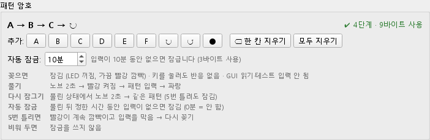
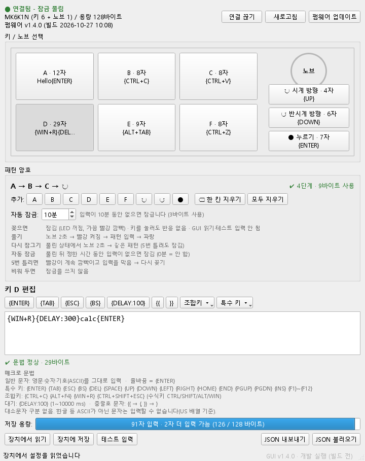
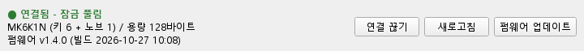
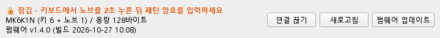
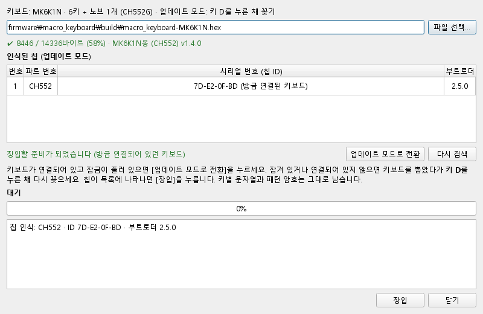

# 미니 매크로 키보드 사용 설명서

키 6개와 노브 1개가 달린 USB 매크로 키보드와, 키마다 넣을 문자열을 설정하는 PC 프로그램(GUI)의 사용 방법입니다.

- 대상: 펌웨어 **v1.4.0**, 설정 프로그램 **GUI 1.4.0**
- 펌웨어를 고치거나 빌드하는 방법은 이 문서가 아니라 [firmware/macro_keyboard/README.md](../firmware/macro_keyboard/README.md)를 보세요.

## 목차

1. [한눈에 보기](#1-한눈에-보기)
2. [처음 사용하기](#2-처음-사용하기)
3. [키보드 사용 방법](#3-키보드-사용-방법)
4. [패턴 암호 (잠금)](#4-패턴-암호-잠금)
5. [설정 프로그램(GUI) 사용 방법](#5-설정-프로그램gui-사용-방법)
6. [문자열 쓰는 법 (매크로 문법)](#6-문자열-쓰는-법-매크로-문법)
7. [문제가 생겼을 때](#7-문제가-생겼을-때)
8. [펌웨어 업데이트](#8-펌웨어-업데이트)
9. [사양](#9-사양)

---

## 1. 한눈에 보기

```
 ┌───────────────────────────────┐
 │  [A]   [B]   [C]      (노브)  │   노브: 돌리기(시계/반시계) + 누르기
 │  [D]   [E]   [F]       LED    │
 └───────────────[USB]───────────┘
```

- **키 A~F**와 **노브의 세 동작**(시계 방향으로 한 칸, 반시계 방향으로 한 칸, 누르기)에 각각 문자열을 하나씩 넣을 수 있습니다. 모두 9개입니다.
- 키를 누르면 저장된 문자열이 **키보드로 타이핑한 것처럼** 입력됩니다. `Hello{ENTER}` 같은 글자뿐 아니라 `{CTRL+C}` 같은 단축키, `{DELAY:500}` 같은 대기도 넣을 수 있습니다.
- 문자열은 PC의 **설정 프로그램(GUI)**으로 넣고 고칩니다. 키보드에 저장되므로, 한 번 저장하면 GUI가 없는 PC에서도 그대로 동작합니다.
- **패턴 암호**를 정해 두면 키보드를 꽂을 때마다 잠기고, 키와 노브로 암호를 입력해야 사용할 수 있습니다.

### LED 색 요약

| LED | 뜻 |
|---|---|
| 꺼져 있고 3초마다 빨강이 짧게 깜빡 | **잠김**. 키를 눌러도 아무 반응이 없습니다 |
| 빨강이 계속 켜짐 | **패턴 암호 입력 중** (풀기 또는 다시 잠그기) |
| 빨강이 계속 깜빡임 (약 0.5초 간격) | **차단**. 암호를 5번 틀렸습니다. 다시 꽂아야 합니다 |
| 파랑 | **사용 가능** (잠금이 풀렸거나 패턴 암호를 쓰지 않음) |
| 초록 (잠깐) | 키를 눌러 문자열을 입력하는 중 |
| 흰색 (0.3초) | GUI에서 설정을 저장함 |
| 보라 | 펌웨어 업데이트 모드로 들어가는 중 |

---

## 2. 처음 사용하기

1. 키보드를 PC의 USB 포트에 꽂습니다. **이때 아무 키도 누르지 마세요.** 키 D나 노브를 누른 채 꽂으면 펌웨어 업데이트 모드로 들어갑니다([8장](#8-펌웨어-업데이트)).
2. Windows가 키보드를 자동으로 인식합니다. 드라이버는 따로 설치하지 않아도 됩니다.
3. 설정 프로그램을 실행합니다([5장](#5-설정-프로그램gui-사용-방법)). 상단에 `● 연결됨`이 보이면 준비된 것입니다.
4. 키를 고르고 문자열을 입력한 뒤 **[장치에 저장]**을 누릅니다. LED가 흰색으로 잠깐 빛나면 저장된 것입니다.
5. 메모장을 열고 키를 눌러 문자열이 입력되는지 확인합니다.

> **한/영 전환 주의**: 키보드는 영문 자판 기준으로 키를 보냅니다. Windows가 **한글 입력 상태**이면 `Hello`가 `ㅗ디ㅣㅐ`처럼 한글로 나옵니다. 문자열을 입력받을 창을 **영문 입력 상태**로 두고 사용하세요.

---

## 3. 키보드 사용 방법

### 키 A~F

- 누르면 그 키에 저장된 문자열이 바로 입력됩니다.
- 문자열이 입력되는 동안 다른 키를 눌러도 됩니다. 최대 8개까지 순서대로 기다렸다가 차례로 입력됩니다.
- 빈 키를 누르면 아무것도 입력되지 않습니다(LED만 초록으로 잠깐 켜짐).

### 노브

| 동작 | 입력되는 것 |
|---|---|
| 시계 방향으로 한 칸 | "노브 시계 방향"에 넣은 문자열 (예: `{RIGHT}`, `{DOWN}`) |
| 반시계 방향으로 한 칸 | "노브 반시계 방향"에 넣은 문자열 (예: `{LEFT}`, `{UP}`) |
| 짧게 누르기 | "노브 누르기"에 넣은 문자열 (예: `{ENTER}`) |
| **2초 누르고 있기** | 패턴 암호 입력 시작 ([4장](#4-패턴-암호-잠금)). 패턴 암호를 쓸 때만 |

- 노브는 한 칸(딸깍) 돌릴 때마다 한 번씩 입력됩니다.
- 패턴 암호를 쓰고 있으면, 노브 누르기 문자열은 **누를 때가 아니라 뗄 때** 입력됩니다. 2초를 넘게 누르고 있으면 문자열 대신 패턴 암호 입력이 시작되기 때문입니다.

### Caps Lock

Caps Lock이 켜져 있어도 저장한 대소문자 그대로 입력됩니다. `Hello`는 Caps Lock과 관계없이 `Hello`로 나옵니다.

---

## 4. 패턴 암호 (잠금)

주변 사람이 키보드를 눌러 저장된 문자열을 쓰지 못하도록 잠그는 기능입니다. 키와 노브를 정해진 순서로 입력하는 것이 암호입니다.

### 패턴 암호 정하기

1. GUI의 **패턴 암호** 칸에서 키/노브 버튼을 순서대로 누릅니다.
   - 버튼: `A`~`F`(키), `↻`(노브 시계 방향 한 칸), `↺`(노브 반시계 방향 한 칸), `●`(노브 누르기)
   - **4~8단계**로 만듭니다. 예: `A → B → C → ↻`
   - 잘못 눌렀으면 **[⌫ 한 칸 지우기]**, 처음부터 하려면 **[모두 지우기]**
2. **[장치에 저장]**을 누릅니다.
3. 저장한 직후에는 잠기지 않습니다. **다음에 키보드를 꽂을 때부터** 잠깁니다.



패턴 암호는 키보드의 저장 공간을 조금 씁니다(4단계면 6바이트). 그만큼 문자열을 적게 넣을 수 있습니다.

### 잠금 풀기

1. 키보드를 꽂으면 **잠김** 상태입니다. LED는 꺼져 있고 3초마다 빨강이 짧게 깜빡입니다. 이때는 키를 눌러도 아무 반응이 없습니다.
2. **노브를 2초 동안 누르고 있습니다.** LED가 **빨강으로 계속 켜지면** 노브를 놓습니다.
3. 패턴 암호를 순서대로 입력합니다. 암호를 입력하는 동안에는 아무것도 타이핑되지 않습니다.
4. 맞으면 LED가 **파랑**이 되고 평소처럼 사용할 수 있습니다.

- **틀리면** 다시 잠김 상태로 돌아갑니다. 노브 2초부터 다시 시작하세요.
- 빨강이 켜진 채로 **10초 동안 아무것도 입력하지 않으면** 입력이 취소되고 잠김으로 돌아갑니다. 이건 틀린 횟수에 들어가지 않습니다.
- **5번 틀리면 차단**됩니다. 빨강이 계속 깜빡이고 아무 입력도 받지 않습니다. USB를 뺐다가 다시 꽂으면 다시 시도할 수 있습니다.
- 키보드를 꽂는 순간 노브를 누르고 있으면 펌웨어 업데이트 모드로 들어갑니다. 노브 2초 누르기는 **꽂은 다음에** 하세요.

### 다시 잠그기

자리를 비울 때는 키보드를 뽑지 않고도 잠글 수 있습니다.

1. 풀린 상태(파랑)에서 **노브를 2초 동안 누르고 있습니다.** LED가 빨강으로 계속 켜집니다.
2. 같은 패턴 암호를 입력하면 잠깁니다(꺼짐 + 가끔 빨강 깜빡).

- 틀리면 잠기지 않고 파랑으로 돌아갑니다. 다시 잠그기를 **5번 틀리면** 그냥 잠깁니다. 이때는 차단이 아니라 잠김이라, 노브 2초 + 맞는 암호로 바로 풀 수 있습니다.
- 10초 동안 입력이 없으면 취소되고 파랑으로 돌아갑니다.
- 키보드를 뺐다가 다시 꽂아도 잠깁니다.

### 자동 잠금

풀린 뒤 한동안 쓰지 않으면 저절로 잠기게 할 수 있습니다(펌웨어 v1.4 이상).

1. GUI의 패턴 암호 칸 아래 **자동 잠금**에 분(1~255)을 넣습니다. **0분이면 자동으로 잠그지 않습니다.**
2. **[장치에 저장]**을 누릅니다.

- 풀린 상태에서 **그 시간 동안 키/노브를 하나도 누르지 않고**, GUI에서 읽기·저장·테스트 입력도 하지 않으면 잠깁니다. GUI를 켜 두기만 하는 것은 입력으로 치지 않습니다.
- 잠기면 GUI 화면의 설정도 지워집니다(저장하지 않은 편집 내용도 함께). 오래 편집할 때는 중간에 저장하세요.
- 패턴 암호가 있을 때만 쓸 수 있습니다. 패턴 암호를 지우면 자동 잠금도 0분이 됩니다.
- 자동 잠금 설정은 3바이트를 씁니다.

### 잠금 끄기

GUI의 패턴 암호 칸에서 **[모두 지우기]**를 누르고 **[장치에 저장]**합니다. 이후에는 꽂자마자 파랑으로 켜집니다.

### 패턴 암호를 잊었을 때

**잠긴 상태 그대로** GUI에서 새 설정을 저장하면 됩니다.

1. 키보드를 꽂고 GUI를 실행합니다. 상단에 `🔒 잠김`이 보입니다.
2. 새로 쓸 문자열을 입력합니다. 패턴 암호 칸은 비워 두거나 새 암호를 넣습니다.
3. **[장치에 저장]**을 누르면 "기존 문자열과 패턴 암호를 모두 지웁니다"라는 경고가 나옵니다. 확인하면 저장됩니다.

- **기존 문자열은 되찾을 수 없습니다.** 잠긴 키보드의 내용을 읽을 수 없게 하는 것이 이 기능의 목적이기 때문입니다.
- 펌웨어를 다시 올려도 문자열과 패턴 암호는 지워지지 않습니다. 잊었을 때는 위 방법을 쓰세요.
- 평소에 [JSON 내보내기](#백업-json-내보내기--불러오기)로 문자열을 백업해 두면 다시 넣기 쉽습니다.

### 보안 수준

패턴 암호는 주변 사람이 키를 눌러 보거나 GUI로 내용을 읽어 가는 것을 막는 정도입니다. 키보드를 가져가 펌웨어를 새로 굽는 것처럼 작정한 공격까지 막지는 못합니다. **비밀번호처럼 민감한 문자열은 넣지 않는 것**을 권장합니다.

---

## 5. 설정 프로그램(GUI) 사용 방법

### 실행

- 배포된 **`MacroKeyboardConfig.exe`**를 실행합니다. Python을 설치하지 않아도 됩니다.
- 저장소에서 바로 실행할 수도 있습니다: `gui\.venv\Scripts\python -m gui` (설치 방법은 [gui/README.md](../gui/README.md))
- 키보드가 꽂혀 있으면 자동으로 연결합니다. 실행한 뒤에 꽂아도 2초 안에 연결됩니다.

### 화면 구성



위에서부터 차례로:

| 영역 | 하는 일 |
|---|---|
| **연결 막대** (맨 위 세 줄) | 연결·잠금 상태, 보드와 저장 용량, 펌웨어 버전. 오른쪽에 [연결 끊기] [새로고침] [펌웨어 업데이트] |
| **키 / 노브 선택** | 키보드 모양 그대로의 버튼. 누르면 그 슬롯을 편집합니다. 버튼마다 글자 수와 문자열 앞부분이 보입니다 |
| **패턴 암호** | 패턴 암호와 자동 잠금 시간을 정하고, 잠금 사용법을 보여 줍니다 ([4장](#4-패턴-암호-잠금)) |
| **편집기** | 고른 슬롯의 문자열을 편집합니다. 위쪽 버튼으로 특수 키를 넣고, 아래에 문법 검사 결과와 문법 요약이 보입니다 |
| **저장 용량** | 전체 글자 수, 더 넣을 수 있는 글자 수, 사용 바이트 |
| **아래 버튼** | [장치에서 읽기] [장치에 저장] [테스트 입력] [JSON 내보내기] [JSON 불러오기]. 맨 아래 오른쪽은 프로그램 버전 |

### 연결 막대





| 표시 | 뜻 |
|---|---|
| `○ 연결 안 됨` | 키보드가 없습니다. 꽂으면 자동으로 연결됩니다. [연결]을 눌러도 됩니다 |
| `● 연결됨 - 잠금 풀림` / `● 연결됨 - 잠금 안 씀` | 사용 가능. 패턴 암호가 있으면 "잠금 풀림", 없으면 "잠금 안 씀" |
| `🔒 잠김 - 키보드에서 노브를 2초 누른 뒤 패턴 암호를 입력하세요` | 키보드가 잠겨 있습니다. 키보드에서 풀면 2초 안에 자동으로 설정을 읽어 옵니다 |
| `🔒 잠김 - 5번 틀려서 입력을 막았습니다. 키보드를 다시 꽂으세요` | 차단 상태입니다. 키보드를 다시 꽂으세요 |

연결되어 있으면 그 아래 두 줄에 **보드와 저장 용량**(`MK6K1N (키 6 + 노브 1) / 용량 128바이트`)과 **펌웨어 버전과 빌드 날짜**(`펌웨어 v1.4.0 (빌드 2026-10-27 09:00)`)가 보입니다. 보드 정보를 보내지 않는 펌웨어(v1.2.x 이하)는 보드 뒤에 `· 보드 정보 없음`이 붙습니다.

**[새로고침]**은 키보드 상태를 바로 다시 확인합니다.

### 연결되지 않았을 때는 아무것도 보이지 않습니다

보안을 위해, 문자열과 패턴 암호는 **키보드가 연결되어 있고 잠금이 풀려 있을 때** 키보드에서 읽어 온 것만 화면에 보입니다.

- 키보드를 뽑거나 키보드에서 다시 잠그면 화면의 내용이 **지워집니다**. 저장하지 않은 편집도 함께 지워지니, 고친 내용은 먼저 저장하세요.
- 연결되지 않은 동안에는 편집기, 패턴 암호, JSON 버튼이 꺼져 있습니다.
- 다시 연결되어 풀리면 키보드에서 자동으로 다시 읽어 옵니다.

### 문자열 편집하기

1. **장치 그림**에서 고칠 키나 노브 동작을 누릅니다. 버튼에는 글자 수와 내용 미리보기가 보입니다.
2. 아래 **편집기**에 문자열을 입력합니다. 문법은 [6장](#6-문자열-쓰는-법-매크로-문법)을 보세요.
   - 편집기 위의 버튼(`{ENTER}`, `{TAB}`, `{DELAY:100}` 등)과 **[조합키 ▾]**, **[특수 키 ▾]** 메뉴로 자주 쓰는 표기를 바로 넣을 수 있습니다.
   - 입력하는 즉시 문법을 검사합니다. 잘못된 곳은 빨간 밑줄로 표시되고, 아래에 몇 행 몇 열이 왜 틀렸는지 나옵니다.
3. 저장하지 않은 슬롯은 버튼에 `*`가, 문법이 틀린 슬롯은 빨간 글씨가 표시됩니다. 창 제목에도 `*`가 붙습니다.

### 저장 용량

키보드에는 모두 **128바이트**를 저장할 수 있습니다. 9개 슬롯 합계 최대 **102자**이고, 패턴 암호를 쓰면 그만큼 줄어듭니다.

- 아래 막대에 `N자 입력 · M자 더 입력 가능`이 표시됩니다. 키마다 길이는 자유롭게 나눠 쓸 수 있습니다(예: 한 키에 40자, 다른 키에 5자).
- `{ENTER}` 같은 표기도 **쓴 글자 수만큼** 차지합니다. `{ENTER}`는 7자입니다.
- 용량을 넘으면 막대가 빨간색이 되고 **[장치에 저장]**이 꺼집니다. 문자열을 줄이세요.

### 장치에 저장

**[장치에 저장]**을 누르면 9개 슬롯과 패턴 암호를 한꺼번에 저장합니다.

- 저장 전에 문법, 용량, 패턴 암호(4~8단계)를 검사합니다. 문제가 있으면 무엇이 문제인지 알려 주고 저장하지 않습니다.
- 확인창에서 [예]를 누르면 저장되고, 키보드 LED가 흰색으로 잠깐 빛납니다.
- 키보드가 문자열을 입력하는 중이면 잠시 기다렸다가 저장합니다.

### 장치에서 읽기

**[장치에서 읽기]**는 키보드에 저장된 내용을 다시 불러옵니다. 화면에서 고치던 내용은 지워지므로, 먼저 확인을 묻습니다. 새 키보드처럼 저장된 설정이 없으면 빈 슬롯으로 시작합니다.

### 테스트 입력

키를 누르지 않고 선택한 슬롯이 제대로 입력되는지 시험합니다.

1. 시험할 슬롯을 고르고 **[테스트 입력]**을 누릅니다.
2. 확인하면 **3초 카운트다운**이 시작됩니다. 그동안 입력받을 창(예: 메모장)을 클릭하세요.
3. 키보드가 그 슬롯의 문자열을 입력합니다.

키보드에 **저장된** 내용이 입력됩니다. 고친 내용을 시험하려면 먼저 저장하세요.

### 백업 (JSON 내보내기 / 불러오기)

- **[JSON 내보내기]**: 9개 슬롯의 문자열을 `.json` 파일로 저장합니다.
- **[JSON 불러오기]**: 저장해 둔 파일을 화면에 불러옵니다. 키보드에 넣으려면 그다음 **[장치에 저장]**을 누르세요.
- **패턴 암호는 백업 파일에 들어가지 않습니다.** 불러와도 화면의 패턴 암호는 바뀌지 않습니다.
- 키보드가 연결되어 있을 때만 쓸 수 있습니다.

### 종료

저장하지 않은 편집이 있으면 종료할 때 확인을 묻습니다.

---

## 6. 문자열 쓰는 법 (매크로 문법)

일반 글자는 그대로 입력되고, `{ }` 안에 쓴 것은 특수한 키나 동작이 됩니다.

| 쓰는 법 | 입력되는 것 | 예 |
|---|---|---|
| 영문, 숫자, 기호 | 그대로 | `Hello, World!` |
| 줄바꿈 (편집기에서 Enter) | Enter 키 | |
| `{ENTER}` `{TAB}` `{ESC}` `{BS}` `{DEL}` `{SPACE}` | Enter, Tab, Esc, Backspace, Delete, 스페이스 | `id{TAB}name{ENTER}` |
| `{UP}` `{DOWN}` `{LEFT}` `{RIGHT}` | 방향키 | 노브에 `{UP}` / `{DOWN}` |
| `{HOME}` `{END}` `{PGUP}` `{PGDN}` `{INS}` | Home, End, Page Up, Page Down, Insert | |
| `{F1}` ~ `{F12}` | 기능 키 | `{F5}` (새로고침) |
| `{CTRL+C}` `{ALT+TAB}` `{WIN+R}` | 조합키 | `{CTRL+S}` (저장) |
| `{CTRL+SHIFT+ESC}` | 수식키 여러 개 조합 | 작업 관리자 |
| `{DELAY:500}` | 0.5초 기다리기 (1~10000밀리초) | `{WIN+R}{DELAY:300}notepad{ENTER}` |
| `{{` / `}}` | 글자 `{` / `}` | `{{OK}}` → `{OK}` |

- 수식키는 `CTRL`, `SHIFT`, `ALT`, `WIN`이고, 마지막에 글자 하나나 키 이름을 씁니다. `+` 글자와 조합하려면 `{CTRL++}`처럼 씁니다.
- 키 이름은 대소문자를 가리지 않습니다(`{enter}`도 됨).
- **한글 등 영문이 아닌 글자는 넣을 수 없습니다.** 키는 미국(US) 자판 기준으로 입력됩니다.

**예시**

| 하고 싶은 것 | 문자열 |
|---|---|
| 이메일 주소 입력 | `myname@example.com` |
| 인사말 두 줄 (영문만 가능) | `Hello,{ENTER}Thank you.` |
| 메모장 열기 | `{WIN+R}{DELAY:300}notepad{ENTER}` |
| 복사 / 붙여넣기 | `{CTRL+C}` / `{CTRL+V}` |
| 창 전환 | `{ALT+TAB}` |
| 노브로 위/아래 이동 | 시계 방향 `{DOWN}`, 반시계 방향 `{UP}` |

---

## 7. 문제가 생겼을 때

| 증상 | 확인할 것 |
|---|---|
| 키를 눌러도 아무것도 입력되지 않고 LED가 꺼져 있다 (가끔 빨강 깜빡) | 고장이 아니라 **잠김** 상태입니다. 노브를 2초 누른 뒤 패턴 암호를 입력하세요 |
| LED가 빨강으로 계속 깜빡이고 아무 반응이 없다 | 암호를 5번 틀려 **차단**되었습니다. USB를 다시 꽂으세요 |
| 영문 대신 `ㅗ디ㅣㅐ`처럼 한글이 나온다 | 입력받는 창이 한글 입력 상태입니다. 한/영 키로 영문으로 바꾸세요 |
| 글자가 일부 빠지거나 순서가 꼬인다 | 프로그램이 입력을 늦게 받는 경우입니다. 문자열 중간에 `{DELAY:100}`을 넣어 보세요 |
| 단축키가 안 먹는다 (예: `{WIN+R}` 뒤 글자가 사라짐) | 창이 뜨기 전에 글자가 입력된 것입니다. `{DELAY:300}`처럼 기다리는 시간을 넣으세요 |
| GUI가 `○ 연결 안 됨`에서 바뀌지 않는다 | USB를 다시 꽂아 보세요. 다른 설정 프로그램 창이 이미 열려 있으면 닫으세요 |
| 꽂았는데 LED가 전혀 켜지지 않고 키보드로도 인식되지 않는다 | 키 D나 노브를 누른 채 꽂아서 펌웨어 업데이트 모드로 들어간 것입니다. 아무것도 누르지 않고 다시 꽂으세요 |
| [장치에 저장]이 꺼져 있다 | 용량을 넘었거나(막대가 빨간색), 패턴 암호가 4단계 미만이거나, 키보드가 연결되지 않았습니다 |
| 펌웨어 업데이트에서 "60초 안에 칩을 찾지 못했습니다" | 키보드를 뽑았다가 키 D를 누른 채 꽂고, 칩이 목록에 나타나면 [장입]을 다시 누르세요. WCHISPTool이 열려 있으면 닫으세요 |
| GUI에서 "펌웨어 v1.0은 패턴 암호를 지원하지 않습니다" | 키보드의 펌웨어가 오래되었습니다. [펌웨어를 업데이트](#8-펌웨어-업데이트)하거나 패턴 암호를 지우세요 |
| 자동 잠금 칸이 꺼져 있다 ("펌웨어 1.4.0 이상 필요") | 키보드의 펌웨어가 v1.3 이하입니다. [펌웨어를 업데이트](#8-펌웨어-업데이트)하세요. 패턴 암호가 없을 때도 꺼져 있습니다 |
| 편집하던 내용이 갑자기 지워지고 `🔒 잠김`이 됐다 | [자동 잠금](#자동-잠금) 시간이 지났습니다. 풀고 다시 읽어 오세요. 오래 편집할 때는 중간에 저장하세요 |
| 패턴 암호를 잊었다 | [패턴 암호를 잊었을 때](#패턴-암호를-잊었을-때)를 보세요 |

더 자세한 기술적인 문제 해결은 [docs/TROUBLESHOOTING.md](TROUBLESHOOTING.md)에 있습니다.

---

## 8. 펌웨어 업데이트

새 펌웨어 파일(`.hex`)을 받았을 때만 필요합니다. 문자열과 패턴 암호는 펌웨어를 바꿔도 그대로 남습니다.

### GUI에서 올리기 (권장)



1. 키보드를 꽂고 GUI에서 **잠금을 푼 상태**(`● 연결됨`)로 둡니다.
2. 상단의 **[펌웨어 업데이트]**를 누릅니다.
3. 펌웨어 파일(`.hex`)을 고릅니다. 저장소에서 빌드한 `macro_keyboard-MK6K1N.hex`가 있으면 처음부터 골라져 있습니다. 파일을 골라도 바로 올리지는 않습니다.
   - 창 맨 위에 이 키보드(예: `MK6K1N · 6키 + 노브 1개 (CH552G)`)와 업데이트 모드로 들어가는 방법이 보입니다.
   - 파일 아래에 크기와 **어느 키보드용 펌웨어인지**(예: `✔ 8446 / 14336바이트 (58%) · MK6K1N용 (CH552) v1.4.0`)가 보입니다. 칩 용량보다 크거나 다른 칩용이면 올릴 수 없습니다.
   - 다른 키보드용이거나 식별 정보가 없는 펌웨어(v1.2.x 이하)는 `⚠`로 표시되고, [장입]을 누를 때 한 번 더 묻습니다.
4. **[업데이트 모드로 전환]**을 누릅니다. 키보드가 업데이트 모드로 바뀌고(보라색 LED) **인식된 칩** 목록에 나타납니다.
   - 목록에는 칩마다 **파트 번호**(예: `CH552`), **시리얼 번호**(칩 고유 ID, 예: `7D-E2-0F-BD`), 부트로더 버전이 표시됩니다. 목록은 1초마다 저절로 새로 고쳐지고, [다시 검색]으로 바로 확인할 수도 있습니다.
   - 방금 GUI에 연결되어 있던 키보드는 시리얼 번호 옆에 `(방금 연결된 키보드)`가 붙습니다(펌웨어 v1.3 이상).
5. 목록에 칩이 하나 보이고 `장입할 준비가 되었습니다`가 나오면 **[장입]**을 누릅니다.
6. 진행 막대가 끝까지 차고 `✔ 장입 완료`가 나오면 **[닫기]**를 누릅니다. GUI가 키보드에 다시 연결하고, 연결 막대에 새 펌웨어 버전과 빌드 날짜가 보입니다.

키보드가 **잠겨 있거나 연결되어 있지 않으면** 4번에서 "키 D를 누른 채 다시 꽂으세요"라는 안내가 나옵니다. 키보드를 뽑았다가 **키 D를 누른 채** 다시 꽂으면 목록에 칩이 나타납니다.

[장입]은 다음 경우에 눌리지 않습니다.

- 목록에 칩이 없을 때
- 칩이 **두 개 이상** 연결되어 있을 때: 어느 칩에 올릴지 알 수 없으니 장입할 키보드 하나만 남기세요.
- 칩이 이 키보드의 칩(MK6K1N은 CH552)이 아닐 때
- 고른 펌웨어가 다른 칩용일 때
- 연결되어 있던 키보드가 GUI의 보드 목록에 없을 때: 업데이트 모드로 들어가는 설정을 모르므로 올리지 않습니다.

- 업로드 중에는 키보드를 뽑지 마세요. 중간에 실패하거나 [취소]했으면 키 D를 누른 채 꽂고 다시 시도하면 됩니다. 업데이트 모드는 펌웨어와 관계없이 항상 들어갈 수 있습니다.
- WCHISPTool 같은 다른 업로드 프로그램은 닫아 두세요.
- 키 D가 안 되면 **노브를 누른 채** 꽂아도 됩니다.

### 스크립트로 올리기

저장소 폴더에서 스크립트를 먼저 실행한 다음, 키보드를 **키 D를 누른 채** 꽂습니다. 업데이트 모드는 몇 초만 유지되므로 순서가 중요합니다.

```powershell
powershell -ExecutionPolicy Bypass -File tools\flash.ps1 -Hex firmware\macro_keyboard\build\macro_keyboard.ino.hex
```

`Verify complete!!!`와 `Reset OK`가 나오면 끝입니다.

---

## 9. 사양

| 항목 | 값 |
|---|---|
| 입력 | 키 6개, 노브 1개 (돌리기 양방향 + 누르기) → 문자열 9개 |
| 저장 용량 | 128바이트 (문자열 합계 최대 102자, 패턴 암호는 `2 + 단계 수`바이트, 자동 잠금은 3바이트) |
| 패턴 암호 | 4~8단계, 키 A~F와 노브 동작 사용. 노브 2초 누르기로 입력 시작, 풀기 5회 실패 시 차단, 입력 없으면 10초 후 취소 |
| 자동 잠금 | 풀린 뒤 0~255분 동안 입력이 없으면 잠김 (0분 = 안 함, 펌웨어 v1.4 이상) |
| 입력 가능한 글자 | 영문, 숫자, 기호(ASCII), 특수 키, 조합키, 대기 |
| 연결 | USB 하나로 키 입력, 설정, 펌웨어 업데이트 |
| PC 프로그램 | Windows, `MacroKeyboardConfig.exe` |
| 칩 | CH552G |
