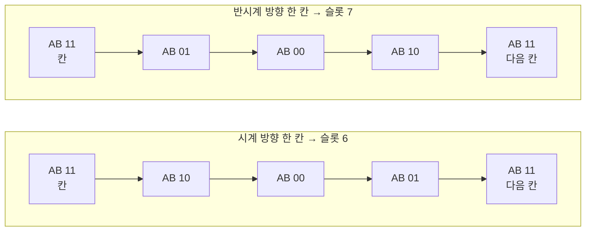
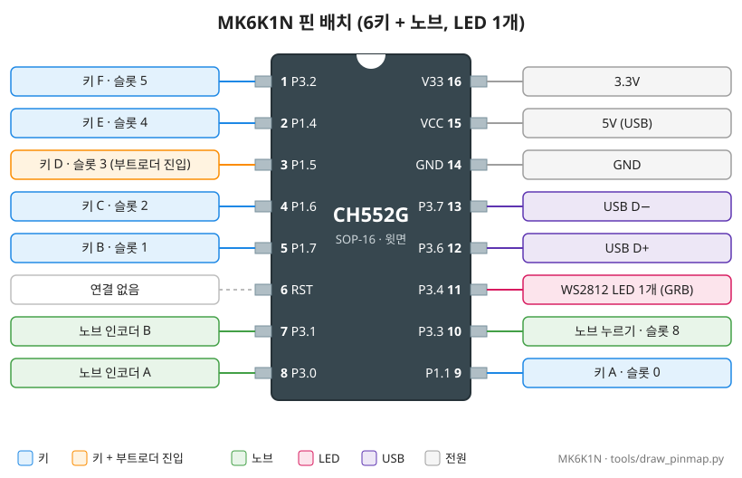
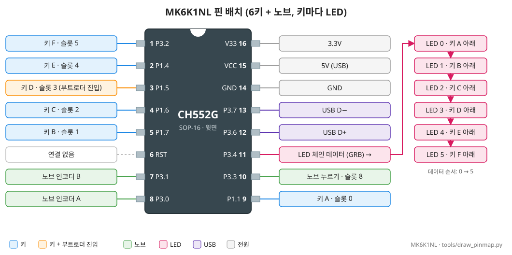

# 키보드별 핀 배치

이 프로젝트가 지원하는 키보드(보드)의 핀 연결입니다. 두 보드 모두 칩은 **CH552G**(SOP-16)이고 키·노브 핀이 같습니다. **LED만 다릅니다.**

| 보드 | 생김새 | LED | 확인한 테스트 펌웨어 | 보드 파일 |
|---|---|---|---|---|
| **MK6K1N** | 6키 + 노브 1개 | 눈에 보이는 LED 1개 | [test_pinmap](../firmware/test_pinmap/README.md) (2026-10-25) | `src/boards/mk6k1n.h` |
| **MK6K1NL** | 6키 + 노브 1개 | **키마다 1개**(6개) | [test_mk6k1nl](../firmware/test_mk6k1nl/README.md) (2026-10-31) | `src/boards/mk6k1nl.h` |

- 핀 번호는 칩의 물리 핀 번호(1~16), `P1.1` 같은 이름은 GPIO, 펌웨어 코드의 핀 번호는 CH55xDuino 방식(`포트 × 10 + 비트`, 예: P1.5 = `15`)입니다.
- 키와 노브 스위치는 누르면 GND에 붙습니다. 펌웨어는 칩 안의 풀업을 켜서 읽습니다(누르면 0).

## 1. CH552G 핀 (두 보드 공통)

```
                     CH552G (SOP-16, 윗면, ○ = 1번 핀 표시)
                    ┌──○──────────────────────┐
   키 F ─────────── │ 1  P3.2        V33   16 │ ─── 3.3V (내부 레귤레이터)
   키 E ─────────── │ 2  P1.4        VCC   15 │ ─── 5V (USB)
   키 D ─────────── │ 3  P1.5        GND   14 │ ─── GND
   (부트로더 진입)  │                          │
   키 C ─────────── │ 4  P1.6        P3.7  13 │ ─── USB D− (UDM)
   키 B ─────────── │ 5  P1.7        P3.6  12 │ ─── USB D+ (UDP)
   (연결 없음) ──── │ 6  RST         P3.4  11 │ ─── LED 데이터 (WS2812 체인)
   노브 인코더 B ── │ 7  P3.1        P3.3  10 │ ─── 노브 누르기
   노브 인코더 A ── │ 8  P3.0        P1.1   9 │ ─── 키 A
                    └─────────────────────────┘
```

| 핀 | GPIO | 연결 | 펌웨어 이름 | 슬롯 |
|---|---|---|---|---|
| 9 | P1.1 | 키 A | `PIN_KEY_A` (11) | 0 |
| 5 | P1.7 | 키 B | `PIN_KEY_B` (17) | 1 |
| 4 | P1.6 | 키 C | `PIN_KEY_C` (16) | 2 |
| 3 | **P1.5** | 키 D, **ROM 부트로더 진입 핀** | `PIN_KEY_D` (15) | 3 |
| 2 | P1.4 | 키 E | `PIN_KEY_E` (14) | 4 |
| 1 | P3.2 | 키 F | `PIN_KEY_F` (32) | 5 |
| 8 | P3.0 | 노브 인코더 A | `PIN_ENC_A` (30) | 6 = 시계 방향, 7 = 반시계 방향 |
| 7 | P3.1 | 노브 인코더 B | `PIN_ENC_B` (31) | ↑ |
| 10 | P3.3 | 노브 누르기 | `PIN_KNOB_SW` (33) | 8 |
| 11 | P3.4 | WS2812 LED 데이터 (GRB) | `PIN_LED` (34) | – |
| 12 / 13 | P3.6 / P3.7 | USB D+ / D− | – | – |
| 6 | RST | 연결 없음 | – | – |

- 남는 GPIO가 없습니다. 그래서 MK6K1NL의 LED 6개도 P3.4 하나에 **체인(직렬)으로** 이어져 있습니다.
- **부트로더 진입**: 펌웨어를 올릴 때 진입 핀을 P1.5로 기록하므로(`vnproch55x -c 1`) **키 D를 누른 채 꽂으면** 업데이트 모드입니다. 우리 펌웨어는 **노브를 누른 채 꽂아도** 부트로더로 들어갑니다. 진입 핀 설정이 P3.6이 되면 **12번(D+)–16번(3V3) 사이에 1.5~2kΩ**을 대고 꽂아야 합니다([TROUBLESHOOTING 2-3](TROUBLESHOOTING.md#2-3-다운로드-실패-후-장치가-전혀-인식되지-않음-복구)).

### 노브 신호

노브(로터리 인코더)는 한 칸(딸깍)마다 A·B 두 선이 4단계를 거칩니다. 칸에서 쉴 때는 두 선 모두 높음(`11`)입니다.



- 펌웨어는 `11`로 돌아올 때 **같은 방향으로 2단계 이상** 움직였으면 한 칸으로 셉니다(v1.5.0부터). 노브가 칸 사이(`10`)에 걸쳐 있을 때 옆 키를 누르는 흔들림으로 `10 ↔ 11`이 한 번 오가는 것은 세지 않습니다.
- 이 보드는 시계 방향이 디코더 기준 음수 방향이라, 펌웨어가 방향을 뒤집어 읽습니다(test_pinmap에서 확인).

## 2. MK6K1N (LED 1개)

윗면 기준 배치:

```
┌──────────────────────────────────────────────┐
│   [ A ]        [ B ]        [ C ]      (노브) │
│   P1.1 · 9     P1.7 · 5     P1.6 · 4   A  P3.0 · 8
│                                        B  P3.1 · 7
│                                        누름 P3.3 · 10
│   [ D ]        [ E ]        [ F ]             │
│   P1.5 · 3     P1.4 · 2     P3.2 · 1          │
│   (부트로더)                                   │
│                                  LED ● P3.4 · 11
└──────────────────────────────────────────────┘
```



- LED가 체인의 몇 번째인지는 확인하지 않았습니다. 그래서 펌웨어는 같은 색을 **8자리에** 보냅니다(`BOARD_LED_COUNT 8`, [TROUBLESHOOTING 3-4](TROUBLESHOOTING.md)).
- LED 하나가 키보드 전체의 상태를 보여 줍니다(잠김, 패턴 입력, 사용 가능, 입력 중 등, [MANUAL LED 색 요약](MANUAL.md#led-색-요약)).
- 제조사 펌웨어에서 업데이트 모드: **키 E를 누른 채 꽂기**(제조사 펌웨어의 기능).

## 3. MK6K1NL (키마다 LED)

키·노브 핀은 MK6K1N과 같고, **키마다 LED가 하나씩** 있습니다. LED는 P3.4에서 시작해 A → B → C → D → E → F 순서로 이어집니다.

```
┌──────────────────────────────────────────────┐
│   [ A ]        [ B ]        [ C ]      (노브) │
│   P1.1 · 9     P1.7 · 5     P1.6 · 4   A  P3.0 · 8
│   LED 0        LED 1        LED 2      B  P3.1 · 7
│                                        누름 P3.3 · 10
│   [ D ]        [ E ]        [ F ]             │
│   P1.5 · 3     P1.4 · 2     P3.2 · 1          │
│   LED 3        LED 4        LED 5             │
└──────────────────────────────────────────────┘
          LED 체인: P3.4 · 11 → 0 → 1 → 2 → 3 → 4 → 5
```



- 펌웨어 설정: `BOARD_LED_COUNT 6`, `BOARD_KEY_LEDS 1`(LED i는 키 i 아래).
- LED 표시(펌웨어 v1.6.0):
  - 사용 가능: 6개 모두 파랑. 키를 누르면 **그 키만 초록**(노브 동작은 6개 모두 초록).
  - 패턴 입력 중: 6개 모두 빨강. 키를 누르면 **그 키만 0.15초 꺼짐**(노브는 6개 모두).
  - 잠김·차단·저장·업데이트 모드: 6개가 같은 색([MANUAL LED 색 요약](MANUAL.md#led-색-요약)).
- 제조사 펌웨어(USB ID `1189:8890`)에서는 **키로 업데이트 모드에 들어가지 않습니다.** 처음 한 번은 **D+ 풀업**(12번–16번, 1.5~2kΩ)으로 들어가서 올립니다. GUI의 펌웨어 업데이트 창은 이 키보드를 식별하지 못하므로 **장입할 보드**에서 MK6K1NL을 고릅니다([MANUAL 8장](MANUAL.md#8-펌웨어-업데이트)).
- 첫 장치: 칩 고유 ID `5E-E0-6E-BF`, 부트로더 2.5.0.

## 4. 그림 다시 그리기

2·3절의 핀 그림(`docs/images/pinmap_*.svg`)은 스크립트로 그립니다. 핀이나 연결이 바뀌면 `tools/draw_pinmap.py`의 `PINS`를 고치고 다시 그립니다:

```powershell
gui\.venv\Scripts\python tools\draw_pinmap.py
```

## 5. 새 키보드를 받으면

1. 칩을 확인합니다(WCHISPTool 칩 목록, 또는 D+ 풀업으로 업데이트 모드에 넣고 업로더 출력의 `Found Device`). **다운로드는 하지 않습니다.**
2. 테스트 펌웨어(MK6K1N 계열이면 [test_pinmap](../firmware/test_pinmap/README.md), LED가 여러 개면 [test_mk6k1nl](../firmware/test_mk6k1nl/README.md))를 올려 키 핀, 노브 신호(RAW 모드), LED 체인 순서와 색 순서를 확인합니다.
3. 결과가 기존 보드와 다르면 보드 파일(`src/boards/<보드>.h`)과 GUI 보드 목록(`gui/boards.py`)을 추가하고, 이 문서에 표와 다이어그램을 더합니다([BOARD_INFO 6~7절](BOARD_INFO.md)).
