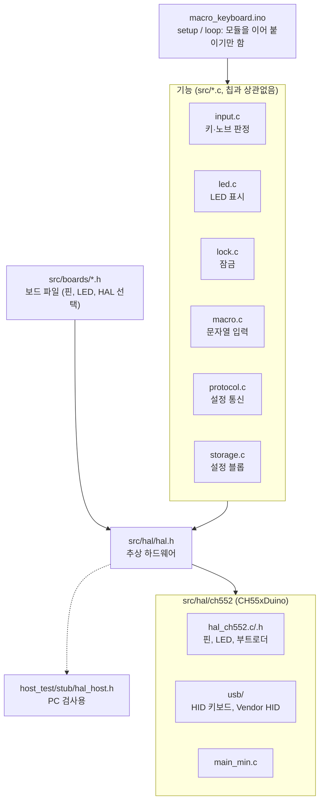

# macro_keyboard: 본 펌웨어 v1.6

- 대상: 6키 + 노브 1개 CH552G 미니 키보드(MK6K1N, MK6K1NL). 보드별 핀은 [docs/PINMAP.md](../../docs/PINMAP.md)
- 키·노브 동작마다 저장된 문자열(매크로)을 HID 키보드 입력으로 출력함
- [gui](../../gui/) 설정 프로그램과 [PROTOCOL.md](../../docs/PROTOCOL.md) v2 규격으로 통신함

## 기능

| 항목 | 내용 |
|---|---|
| USB 구성 | 인터페이스 0: HID 키보드, 인터페이스 1: 설정용 Vendor HID (64바이트) |
| 슬롯 | 키 A~F, 노브 시계 방향/반시계 방향/누르기 (9개) |
| 저장 | DataFlash 128바이트. 헤더와 슬롯 길이 정보 26바이트를 빼면 **9개 슬롯 합계 102자** (패턴 암호를 쓰면 `2 + 단계 수`바이트만큼 줄어듦) |
| 매크로 | `{ENTER}` `{TAB}` `{UP}` `{F5}` 등 키 이름, `{CTRL+C}` 같은 조합키, `{DELAY:n}`, `{{` `}}` |
| Caps Lock | 켜져 있어도 영문 대소문자가 쓴 그대로 입력되도록 보정 |
| 연속 입력 | 출력 중에 누른 키는 최대 8개까지 순서대로 대기 |
| 잠금 (v1.1, v1.2에서 변경) | 패턴 암호 저장 시 꽂을 때마다 잠긴 상태로 시작, 키에 반응 안 함. **노브 2초 누른 뒤** 패턴(2~8단계, v1.5 이하는 4~8단계) 입력하면 풀림. 풀린 상태에서 같은 방법으로 다시 잠금. v1.4부터 GUI에서 정한 시간(분) 동안 입력 없으면 자동 잠금(0분 = 안 함). 상태도는 [README의 잠금 상태도](../../README.md#잠금-상태도) |

### LED (WS2812 1개)

| 색 | 의미 |
|---|---|
| 꺼짐 + 3초마다 빨강이 짧게(0.1초) 깜빡 | 잠김: 키를 눌러도 반응 없음. 노브를 2초 눌러 패턴 입력 시작 |
| 빨강 (계속 켜짐) | 패턴 입력 중 (풀기 또는 다시 잠그기) |
| 빨강 깜빡임 (약 0.5초 간격) | 풀기를 5번 틀려서 입력 막음. 다시 꽂아야 함 |
| 파랑 | 풀림 (패턴 암호가 없을 때도) |
| 초록 | 키를 누름 (최소 0.2초, 문자열 출력하는 동안 계속) |
| 흰색 (0.3초) | 설정 저장 완료 |
| 보라 | 부트로더로 들어가는 중 (v1.0은 빨강) |

### 부트로더 진입 (펌웨어 업데이트)

| 방법 | 동작 |
|---|---|
| **키 D를 누른 채 USB 연결** | ROM 부트로더(P1.5) |
| **노브를 누른 채 USB 연결** | 펌웨어가 부트로더로 점프 (키 D 방법이 안 될 때의 예비) |
| GUI의 BOOT 명령 | 지원함(GUI 화면에는 아직 버튼 없음). 잠긴 동안에는 거부 |

### 잠금

1. GUI **패턴 암호** 칸에서 키/노브 버튼을 순서대로 눌러 패턴(2~8단계)을 만들고 **[장치에 저장]**
   - 저장 직후에는 풀린 상태 유지, **다음에 꽂을 때부터** 잠김
2. 꽂으면 **잠김** 상태
   - LED 꺼짐, 3초마다 빨강이 짧게 깜빡
   - 키·노브 반응 없음(틀린 횟수에도 안 들어감)
3. **노브를 2초 누르면** LED가 **빨강으로 계속 켜짐** → 노브를 놓고 패턴을 순서대로 입력
   - 노브 누르기 ●도 패턴에 쓸 수 있음
4. 맞으면 LED **파랑**, 평소처럼 동작
   - 패턴 입력은 타이핑되지 않음
   - 이후 키 누를 때마다 초록이 잠깐 켜짐
5. 틀리면 잠김(꺼짐 + 가끔 깜빡)으로 돌아감 → 다시 노브 2초부터
   - 빨강인 채로 10초간 입력 없으면 취소, 잠김으로 돌아감(틀린 횟수에 안 들어감)
6. **5번 틀리면** 빨강이 계속 깜빡이며 입력 안 받음 → 다시 꽂으면 재시도 가능
7. **다시 잠그기**: 풀린 상태에서 노브 2초 → 빨강 → 같은 패턴 입력하면 잠김
   - 패턴 입력은 타이핑되지 않음
   - 틀리면 풀린 상태(파랑)로 돌아감
   - **5번 틀리면 그냥 잠김**(차단이 아니라 잠김이라 노브 2초 + 맞는 패턴으로 바로 풀림)
   - 10초간 입력 없으면 잠그지 않고 파랑으로 돌아감

주의할 점:

- 패턴 암호가 저장되어 있으면 노브 누르기 문자열은 **누를 때가 아니라 뗄 때** 입력됨
  - 2초 넘게 누르면 패턴 입력이 시작되고 문자열은 입력 안 됨
  - 패턴 암호가 없으면 예전처럼 누를 때 입력됨
- 꽂는 순간 노브를 누르고 있으면 부트로더로 들어감 → 2초 누르기는 **꽂은 뒤에**
- 잠긴 동안 GUI에서 읽기·테스트 입력 안 됨
- 패턴을 잊으면 GUI에서 새 설정을 **[장치에 저장]** (기존 문자열과 패턴은 모두 지워짐)
- 잠금은 주변 사람이 키를 눌러 보는 것을 막는 정도임
  - 펌웨어를 새로 구워 DataFlash를 읽는 것은 못 막음 → 비밀번호 같은 민감한 문자열은 저장하지 말 것

## 빌드

- Arduino IDE + CH55xDuino 0.0.26
- Windows는 [TROUBLESHOOTING 1-1](../../docs/TROUBLESHOOTING.md)의 `sdcc.sh` 패치 필요

| Tools 메뉴 | 값 |
|---|---|
| Board | CH552 Board |
| Clock Source | 24 MHz (internal), 5V |
| USB Settings | **USER CODE w/ 266B USB ram** ⚠️ test_pinmap(148B)과 다름 |
| Bootloader pin | **P1.5 pull-down** |

**빌드 스크립트 (권장)**

- 저장소 폴더에서 실행, 위 보드 설정으로 빌드하고 **빌드한 시각**을 펌웨어에 넣음
- 결과: `firmware\macro_keyboard\build\macro_keyboard.ino.hex`

```powershell
powershell -ExecutionPolicy Bypass -File tools\build_fw.ps1
```

**Arduino IDE**

- **Sketch → Export Compiled Binary** → `build\CH55xDuino.mcs51.ch552\macro_keyboard.ino.hex` 생성
- 빌드 날짜가 안 들어감(GUI에 `빌드 날짜 없음`)

### 버전과 빌드 날짜

- **버전**: `src/config.h`의 `FW_MAJOR`, `FW_MINOR`, `FW_PATCH`를 직접 고침(지금 `1.6.0`)
  - USB 장치 정보(bcdDevice)에도 같은 값이 들어감
- **빌드 날짜**: `tools/build_fw.ps1`이 빌드 순간의 시각을 컴파일 옵션(`-DFW_BUILD_YEAR=2026` 등)으로 넘김
  - 컴파일러의 `__DATE__`를 안 쓰는 이유: Arduino는 바뀌지 않은 파일을 다시 컴파일하지 않아 예전 날짜가 남음
- GUI 연결 막대 표시: `펌웨어 v1.1.0 (빌드 2026-10-26 11:40)` 형식. 펌웨어 1.0은 `펌웨어 v1.0`으로만 보임

### 크기 기록

- 확인 결과(2026-10-31, v1.6.0, HAL 분리 후):

| 보드 | 코드 | 전역 변수 | 스택 | 비고 |
|---|---|---|---|---|
| MK6K1N | 8694바이트(60%) | 360바이트 | 126바이트 | 나누기 전 8610바이트 |
| MK6K1NL | 8915바이트(62%) | 358바이트 | 120바이트 | 키별 LED 표시. 나누기 전 8795바이트 |

- HAL 분리([코드 구조](#코드-구조))로 모듈 사이 호출이 늘어 84~120바이트 커짐
- 이전 버전 크기(MK6K1N 기준, 변화는 바로 아래 버전 대비):

| 버전 | 크기 | 변화 |
|---|---|---|
| v1.5.0 | 8608바이트 (MK6K1NL 8895) | 노브 판정 변경(+14바이트): 한 칸 안에서 2단계 이상 같은 방향이어야 회전 |
| v1.4.1 | 8594바이트 | USB 전송 멈춤 처리(+148바이트) |
| v1.4.0 | 8446바이트 | 자동 잠금(+178바이트) |
| v1.3.x | 8268바이트 | v1.3.0: HELLO 보드 정보와 펌웨어 식별 문자열(+117바이트) |
| v1.2.1 | 8151바이트 | 기능 그대로, 크기만 줄임([docs/FIRMWARE_SIZE.md](../../docs/FIRMWARE_SIZE.md)) |
| v1.2.0 | 11587바이트(80%) | – |

### 보드 파일

- 칩, 키/노브 수, 키 배치 행 수, 보드 이름, 핀 배치, LED 수는 **보드 파일** `src/boards/<보드>.h`에 있음([docs/BOARD_INFO.md](../../docs/BOARD_INFO.md) 6)

| 보드 파일 | 보드 | LED | 하드웨어 확인 |
|---|---|---|---|
| `mk6k1n.h` | MK6K1N: 6키 + 노브 | 눈에 보이는 LED 1개(체인 위치를 몰라 8자리에 같은 색) | [test_pinmap](../test_pinmap/README.md) |
| `mk6k1nl.h` | MK6K1NL: 6키 + 노브, 핀은 MK6K1N과 같음 | **키마다 1개**(체인 0~5 = 키 A~F). 누른 키만 초록, 나머지는 파랑. 패턴 입력 중(전체 빨강)에는 누른 키만 잠깐 꺼짐 | [test_mk6k1nl](../test_mk6k1nl/README.md) |

- **공통 기판 파일** `ch552_6k1n.h`: 두 보드가 같은 기판이라 칩·키/노브 수·행 수·핀·스위치 비트 표·핀 배치 검사(`#error`)를 한 곳에 둠
  - HAL 선택(`BOARD_HAL_CH55X`)도 여기서 정함
- `mk6k1n.h` / `mk6k1nl.h`: 각자 이름(`BOARD_NAME`)과 LED(`BOARD_LED_COUNT`, `BOARD_KEY_LEDS`: 1 = LED i가 키 i 아래)를 정한 뒤 `ch552_6k1n.h`를 include함
- 핀 그림: [docs/PINMAP.md](../../docs/PINMAP.md)
- 새 보드 추가:
  - 기판(핀)이 같으면: 이름과 LED만 정한 보드 파일 하나
  - 기판이 다르면: `<칩>_<배치>.h` 같은 공통 파일도 새로 만들고, `src/config.h`의 고르기 목록과 `tools/build_fw.ps1`의 `$boardChips`에 더함
- 빌드 시 보드 고르기:

| 명령 | 매크로 | 추가 복사본 |
|---|---|---|
| `tools/build_fw.ps1 -Board mk6k1n` | `-DBOARD_MK6K1N` | `build/macro_keyboard-MK6K1N.hex` |
| `tools/build_fw.ps1 -Board mk6k1nl` | `-DBOARD_MK6K1NL` | `build/macro_keyboard-MK6K1NL.hex` |
| `-Board` 생략, Arduino IDE 빌드 | 없음 → `mk6k1n` | – |

- `macro_keyboard-<보드>.hex`는 GUI 펌웨어 업데이트 창이 먼저 고르는 파일
- 보드 정보 전달:
  - HELLO 바이트 17~35([docs/PROTOCOL.md](../../docs/PROTOCOL.md))
  - hex 안 식별 문자열 `MKFW1:<보드>:<칩>:<버전>`(예: `MKFW1:MK6K1N:CH552:1.3.0`) → GUI가 올리기 전에 보드와 칩 확인
- 보드 이름은 GUI 보드 목록 `gui/boards.py`와 같아야 함

## 업로드

**GUI (가장 쉬움)**

- 이 펌웨어(v1.0 이상)가 이미 올라가 있으면 **GUI의 [펌웨어 업데이트]** 사용
- 잠금이 풀린 키보드는 GUI가 BOOT 명령으로 업데이트 모드에 넣음 → 키 D 누를 필요 없음([사용 설명서 8장](../../docs/MANUAL.md#8-펌웨어-업데이트))

**스크립트**

1. 저장소 폴더에서 실행
2. **키 D를 누른 채** 키보드 연결
3. 아래 명령 실행 (`build_fw.ps1`로 빌드한 경우)

```powershell
powershell -ExecutionPolicy Bypass -File tools\flash.ps1 -Hex firmware\macro_keyboard\build\macro_keyboard.ino.hex
```

- Arduino IDE로 빌드했으면 `-Hex firmware\macro_keyboard\build\CH55xDuino.mcs51.ch552\macro_keyboard.ino.hex`

**업로드 후**

- LED **파랑** = 펌웨어 실행 중
- 처음에는 **모든 슬롯이 빈 상태**로 시작함(DataFlash에 이전 제조사 설정이 남아 있어도 형식이 맞지 않음)

## 동작 테스트

### 1. 연결 확인

1. GUI 실행: `gui\.venv\Scripts\python -m gui`
2. 상단에 `● 연결됨 - …`, `MK6K1N (키 6 + 노브 1) / 용량 128바이트`, `펌웨어 v1.6.0 (빌드 …)` 표시되면 설정 통신 정상
   - 빌드 날짜가 방금 빌드한 시각인지 확인(새 펌웨어가 올라갔다는 표시)
3. 처음에는 "설정 없음"으로 빈 슬롯 9개 표시

### 2. 테스트 문자열 넣기

- 아래 문자열을 슬롯마다 입력하고 **[장치에 저장]** (9개 합계 85자, 전체 111 / 128바이트)
- LED가 흰색으로 잠깐 빛나면 저장 완료

| 슬롯 | 테스트 문자열 | 확인하는 것 |
|---|---|---|
| 키 A | `Hello, World!{ENTER}` | 대소문자, 기호, Enter |
| 키 B | `abc{DELAY:1000}def` | 1초 쉬었다가 이어서 입력 |
| 키 C | `{{OK}}` | 중괄호 입력 → `{OK}` |
| 키 D | `{CTRL+A}` | 조합키 (전체 선택) |
| 키 E | `{CTRL+C}` | 조합키 (복사) |
| 키 F | `{CTRL+V}` | 조합키 (붙여넣기) |
| 노브 시계 방향 | `{DOWN}` | 한 칸마다 아래 화살표 |
| 노브 반시계 방향 | `{UP}` | 한 칸마다 위 화살표 |
| 노브 누르기 | `{ENTER}` | Enter |

### 3. 키보드로 확인

1. **메모장**을 열고 **영문 입력 모드**로 둠
2. 키 A → `Hello, World!` 입력 후 줄바꿈
3. 키 B → `abc` 입력, 1초 뒤 `def`
4. 키 C → `{OK}`
5. 키 D(전체 선택) → 키 E(복사) → 메모장 끝 클릭 → 키 F(붙여넣기)
6. 노브를 돌려 커서가 위/아래로 움직이는지, 노브를 눌러 줄바꿈되는지 확인
7. **Caps Lock을 켜고** 키 A를 다시 눌러도 `Hello, World!` 그대로 나오는지 확인
8. USB를 뺐다 다시 꽂고, GUI **[장치에서 읽기]**로 저장한 문자열이 남아 있는지 확인

- GUI **[테스트 입력]**: 키를 누르지 않고 선택한 슬롯을 입력해 봄(3초 카운트다운 뒤 포커스된 창에 입력)

### 4. 잠금 확인

1. GUI 패턴 암호에 `A → B → C → ↻`(키 A, B, C, 노브 시계 방향 한 칸)를 넣고 저장(전체 117 / 128바이트). LED는 파랑 그대로
2. USB를 뺐다 다시 꽂음 → LED **빨강**, GUI 상단에 `🔒 잠김 - 키보드에서 노브를 2초 누른 뒤 패턴 암호를 입력하세요` 표시
3. 메모장에서 키 A를 눌러도 아무것도 입력 안 되는지 확인
4. 노브를 누르지 않고 `A, B, C, ↻`를 입력해도 안 풀리는지 확인
5. 노브 2초 → **빨강이 계속 켜지면** `A, B, D, ↻`처럼 틀리게 입력 → 잠김(꺼짐 + 가끔 깜빡)으로 돌아오는지 확인
6. 다시 노브 2초 → `A, B, C, ↻` 입력 → LED **파랑**, 2초 안에 GUI가 `● 연결됨`으로 바뀌고 설정을 읽어 오는지 확인
7. 노브를 짧게 누르면 노브 누르기 문자열이 (뗄 때) 입력되는지 확인
8. **다시 잠그기**: 노브 2초 → 빨강 → `A, B, C, ↻` 입력 → 잠김(꺼짐 + 가끔 깜빡)이 되고 2초 안에 GUI가 `🔒 잠김`으로 바뀌는지 확인
   - 다시 푼 뒤 다시 잠그기를 5번 틀리면 5번째에 잠기는지도 확인
9. 다시 꽂은 뒤 5번 틀리게 입력(매번 노브 2초 후) → 빨강 깜빡임, 맞는 패턴도 안 받는지 확인
10. **자동 잠금** (v1.4): 풀린 상태에서 GUI 자동 잠금을 `1분`으로 저장(설정이 3바이트 늘어남)
    - 아무것도 안 누르고 1분 기다림 → 잠김(꺼짐 + 가끔 깜빡), 2초 안에 GUI가 `🔒 잠김`으로 바뀌는지 확인
    - 다시 풀고 1분 전에 키 하나 누르면 그때부터 1분을 새로 세는지 확인
11. 끝나면 GUI에서 패턴 암호 **모두 지우기** 후 저장 → 잠금 꺼짐(자동 잠금도 함께 0분)

### 5. 용량 확인

- GUI 아래쪽 막대에 `N자 입력 · M자 더 입력 가능 (사용 / 128 바이트)` 표시
- 128바이트를 넘으면 빨간색으로 바뀌고 저장 버튼 꺼짐

## 문제가 생기면

| 증상 | 확인할 것 |
|---|---|
| 업로드 후 키보드로 인식되지 않음 | 장치 관리자에 "알 수 없는 장치"가 보이면 USB Settings가 **266B**였는지 확인하고 다시 빌드 |
| GUI가 "연결 안 됨" | 장치 관리자 HID 장치에 `Mini Macro Kbd`가 두 개(키보드, 공급업체 정의 장치) 있는지 확인. 다른 GUI 창이 장치를 잡고 있지 않은지 확인 |
| 영문 대신 한글이 입력됨 | 한/영 키로 영문 모드 전환 ([TROUBLESHOOTING 3-1](../../docs/TROUBLESHOOTING.md)) |
| 다시 업로드해야 함 | 키 D 또는 노브를 누른 채 연결 |
| 패턴 암호를 잊음 | 잠긴 채로 GUI에서 새 설정 **[장치에 저장]** (기존 문자열과 패턴은 지워지고 되찾을 수 없음). 펌웨어를 다시 올려도 DataFlash 설정은 안 지워지므로 그것으로는 안 풀림 |

- 자세한 내용: [docs/TROUBLESHOOTING.md](../../docs/TROUBLESHOOTING.md)

## 코드 구조

- 기능 코드와 하드웨어를 나눔(2026-10-31)
- 기능 코드(`src/*.c`)는 하드웨어를 **`src/hal/hal.h`의 이름으로만** 씀
  - 시간, 스위치, 노브 선, LED, 설정 저장, HID 키보드, 설정 통신, 부트로더
- 칩별 구현은 `src/hal/<칩>/`. 보드 파일의 `BOARD_HAL_CH55X`를 보고 `hal.h`가 고름
- CH55x에서는 대부분 매크로라 HAL 계층 자체는 코드가 거의 늘지 않음



| 파일 | 내용 |
|---|---|
| `macro_keyboard.ino` | `setup()`과 `loop()`: 모듈을 순서대로 부르기만 함 |
| `src/config.h` | 버전, 빌드 날짜, USB ID, 보드 파일 고르기, 슬롯 번호, 용량, 잠금 설정값 |
| `src/boards/ch552_6k1n.h` | 6키 + 노브 CH552G 기판: HAL 선택, 칩, 키/노브/행 수, 핀 배치, 스위치 비트 표, 핀 배치 검사 (MK6K1N, MK6K1NL 공통) |
| `src/boards/mk6k1n.h`, `mk6k1nl.h` | 보드 이름과 LED (LED 1개를 8자리로 / 키마다 1개) |
| `src/input.c/.h` | 스위치 디바운스(20ms), 노브 판정(한 칸 중 2단계 이상), 노브 길게 누르기, 입력을 잠금/문자열 입력으로 보내기 |
| `src/led.c/.h` | LED 표시 정책(색, 깜빡임, 키별 초록/꺼짐), 색 번호 `COLOR_*`(`led.h`)와 색 표 `hal_palette` |
| `src/lock.c/.h` | 잠금 상태, 패턴 입력 판정, 틀린 횟수, 자동 잠금 시간 |
| `src/protocol.c/.h` | Vendor HID 명령 처리 (HELLO/READ/WRITE/COMMIT/TEST/BOOT), HELLO 보드 정보, 펌웨어 식별 문자열 |
| `src/storage.c/.h` | 설정 블롭 저장, CRC 검사, 슬롯 찾기 (문자열, 패턴 암호, 설정 슬롯) |
| `src/macro.c/.h` | 매크로 해석과 비동기 출력 (키 누름/뗌, DELAY) |
| `src/hal/hal.h` | **추상 하드웨어**: 기능 코드가 쓰는 이름 목록과 설명, 칩 구현 고르기 |
| `src/hal/ch552/hal_ch552.c/.h` | CH55x 구현: 핀 설정, 스위치·노브 읽기(포트 직접), WS2812 LED, DataFlash(코어 `eeprom_*` 매크로), 칩 고유 ID, 부트로더 |
| `src/hal/ch552/usb/` | USB 디스크립터, 요청 처리, 엔드포인트 (CH55xDuino qmkCompatibleKeyboard 예제 기반, LGPL-2.1) |
| `src/hal/ch552/main_min.c` | 코어의 `main.c` 대신 쓰는 작은 `main()`과 인터럽트 표(USB, Timer0) |

### PC 검사 (host_test)

- `firmware/host_test/run.py`로 기능 코드(`storage.c`, `macro.c`, `lock.c`, `input.c`, `led.c`)를 PC(gcc)에서 검사함
- 하드웨어 대신 `host_test/stub/hal_host.h` 사용
- 확인 항목:
  - GUI 인코더로 만든 블롭 저장
  - 각 슬롯이 보내는 HID 키 코드
  - 패턴 암호 판정
  - 가짜 스위치·노브 선을 넣었을 때의 입력과 LED 표시(두 보드 모두)

```powershell
gui\.venv\Scripts\python firmware\host_test\run.py
```
